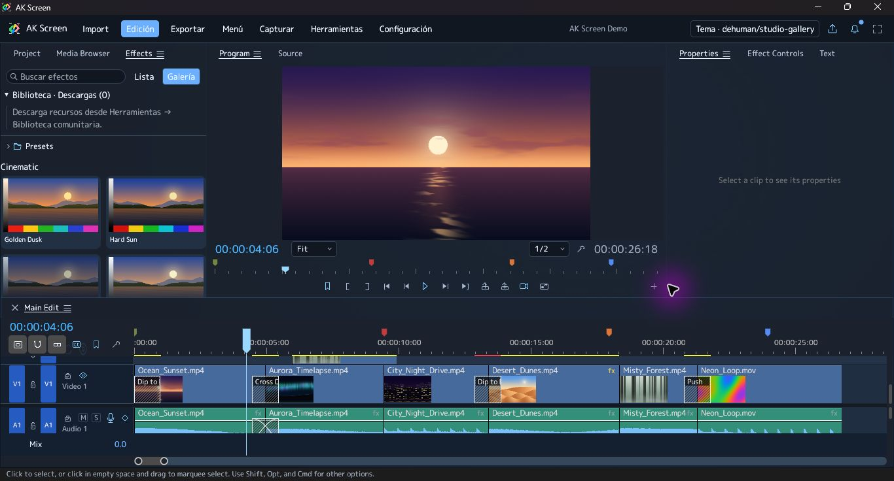

# Studio Gallery

Tema de dehuman para AK Screen 2.4.0. La imagen siguiente es una **captura real de la aplicación instalada en Windows**, con medios de demostración generados por el editor.

Incluye 47 colores, 11 medidas, disposición de composición, estilos nativos de la galería de efectos, 24 iconos SVG, tipografía local, fondo WebP original y pantalla de carga animada en GIF.

La cantidad de columnas depende también del ancho disponible del panel. El CSS usa los selectores y propiedades compatibles con el editor nativo; no ejecuta JavaScript.

Puedes previsualizar el paquete desde **Theme Studio → Temas publicados**, crear una variante y conservar sus recursos y licencias al exportar el ZIP. Los cambios de layout y estilos deben comprobarse después dentro de AK Screen.

Consulta [LICENSE.txt](LICENSE.txt) y [FONT_LICENSE.md](FONT_LICENSE.md) antes de redistribuir una variante.
